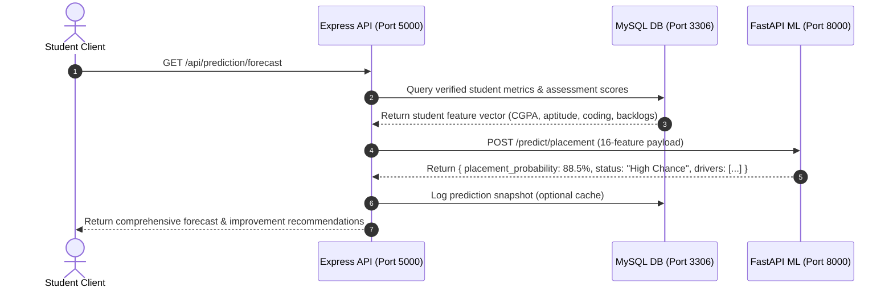

# 09 — System Architecture

## 1. System Architecture Overview

EduPredict is built on a high-throughput, modular, 4-tier microservice-assisted architecture designed for horizontal scalability, data consistency, and low-latency machine learning inference.

```
┌─────────────────────────────────────────────────────────────────────────────┐
│                           CLIENT PRESENTATION TIER                          │
│                                                                             │
│   [ React 18 SPA (Vite) ]                  [ Google Stitch UI (Tailwind v4)]│
│   Port: 3000                               Port: 3001                       │
│   • React Router, Auth Context             • Modern Glassmorphic Dashboard  │
│   • Coding Arena IDE (Syntax/Line No.)     • Interactive Recharts Analytics │
│   • Timed Quiz UI & Realtime Badges        • Multi-Role Specialized Portals │
└──────────────────────────────────────┬──────────────────────────────────────┘
                                       │ HTTPS / REST (JSON)
                                       ▼
┌─────────────────────────────────────────────────────────────────────────────┐
│                        APPLICATION & BUSINESS LOGIC TIER                    │
│                                                                             │
│   [ Node.js & Express REST API Server ] (Port: 5000)                        │
│   ├── Middleware Pipeline (CORS, RateLimiter, JWT RBAC, Multer File Handler)│
│   ├── Controllers: Auth, Admin, Teacher, Student, Assessment, Coding        │
│   ├── Services: CareerAI, ResumeService, NotificationService, MLService     │
│   └── Execution Sandbox (Isolated `vm.runInContext` Testcase Runner)        │
└──────────────────────┬──────────────────────────────────────┬───────────────┘
                       │                                      │
                       │ MySQL Protocol (Pool)                │ HTTP / REST
                       ▼                                      ▼
┌──────────────────────────────────────┐  ┌───────────────────────────────────┐
│           DATA STORAGE TIER          │  │       PREDICTIVE ML TIER          │
│                                      │  │                                   │
│   [ MySQL 8.0 Relational Database ]  │  │   [ FastAPI ML Service ] (Port:8000│
│   Port: 3306                         │  │   • Uvicorn ASGI Server           │
│   • 3NF Normalized Institutional Data│  │   • 16-Feature Scikit-learn Model │
│   • Precomputed Metrics Tables       │  │   • Logistic Regression / XGBoost │
│   • Analytical Materialized Views    │  │   • Feature Impact & Drivers      │
│   • Stored Procedures & Triggers     │  │   • Batch Cohort Forecasting      │
└──────────────────────────────────────┘  └───────────────────────────────────┘
```

---

## 2. Tier Details & Responsibilities

### 2.1 Presentation Tier
- **Frontend SPA (Port 3000)**: Original complete React 18 application with custom modern CSS, client-side routing, protected route guards, and live API integration across all modules.
- **Google Stitch Frontend (Port 3001)**: Next-generation modern dashboard interface built using React 18, Vite, and Tailwind CSS v4, providing rich aesthetic card designs, responsive grids, and Recharts data visualizations.

### 2.2 Application Tier (Express API - Port 5000)
- **Routing & Controllers**: 14 route files mapping cleanly to 13 modular controllers.
- **Security & Authorization**: `auth.js` middleware intercepting all requests, verifying HMAC-SHA256 JWT tokens, and enforcing role hierarchy permissions (`admin`, `teacher`, `student`).
- **File Upload Service**: Multer middleware managing multipart document uploads to `backend/uploads/` with size, extension, and MIME validation.
- **Code Execution Sandbox**: Secure in-memory evaluator executing student test solutions against public and hidden test cases.

### 2.3 Data Storage Tier (MySQL - Port 3306)
- **Transactional Consistency**: Relational database modeling users, roles, departments, courses, batches, assessments, coding problems, submissions, and job drives.
- **Performance Optimization**: Composite indexing on foreign keys and status columns. Cached metrics tables (`student_metrics`, `department_metrics`) updated via triggers/stored procedures.

### 2.4 Predictive ML Tier (FastAPI - Port 8000)
- **High-Performance Async Microservice**: FastAPI server handling single-student predictions (`/predict/placement`), batch cohort forecasting (`/predict/batch`), and explainability drivers (`/predict/explain`).
- **Trained Pipeline**: Scikit-learn pipeline bundle with StandardScaler and Logistic Regression / XGBoost achieving 89.84% ROC-AUC.

---

## 3. Communication Flows & Data Lifecycles


