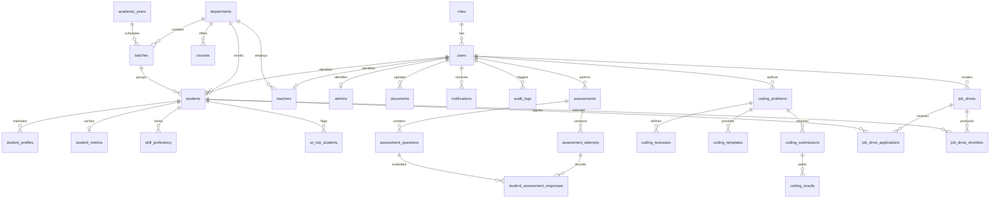

# 13 — Entity Relationship (ER) Diagram

## 1. Visual Entity Relationship Diagram

The following Mermaid diagram represents the complete relational schema and cardinality relationships across the EduPredict ecosystem.

---

## 2. Cardinality & Relationship Matrix

| Primary Entity | Related Entity | Cardinality | Constraint / Foreign Key Rule |
| :--- | :--- | :---: | :--- |
| `roles` | `users` | 1 : N | `ON UPDATE CASCADE ON DELETE RESTRICT` |
| `users` | `students` | 1 : 1 | `ON UPDATE CASCADE ON DELETE CASCADE` |
| `users` | `teachers` | 1 : 1 | `ON UPDATE CASCADE ON DELETE CASCADE` |
| `departments` | `batches` | 1 : N | `ON UPDATE CASCADE ON DELETE RESTRICT` |
| `batches` | `students` | 1 : N | `ON UPDATE CASCADE ON DELETE RESTRICT` |
| `users` | `documents` | 1 : N | `ON UPDATE CASCADE ON DELETE CASCADE` |
| `assessments` | `assessment_questions` | 1 : N | `ON UPDATE CASCADE ON DELETE CASCADE` |
| `assessment_attempts` | `student_assessment_responses` | 1 : N | `ON UPDATE CASCADE ON DELETE CASCADE` |
| `coding_problems` | `coding_testcases` | 1 : N | `ON UPDATE CASCADE ON DELETE CASCADE` |
| `coding_problems` | `coding_submissions` | 1 : N | `ON UPDATE CASCADE ON DELETE CASCADE` |
| `coding_submissions` | `coding_results` | 1 : N | `ON UPDATE CASCADE ON DELETE CASCADE` |
| `job_drives` | `job_drive_applications` | 1 : N | `ON UPDATE CASCADE ON DELETE CASCADE` |
| `job_drives` | `job_drive_shortlists` | 1 : N | `ON UPDATE CASCADE ON DELETE CASCADE` |

---

## 3. Data Dictionary Key Attributes

### `users`
- `id` (INT, PK, Auto-Increment)
- `role_id` (INT, FK -> `roles.id`)
- `email` (VARCHAR(255), UNIQUE, NOT NULL)
- `password_hash` (VARCHAR(255), NOT NULL)
- `user_id_number` (VARCHAR(100), UNIQUE, NOT NULL)
- `full_name` (VARCHAR(255), NOT NULL)
- `status` (ENUM('pending', 'active', 'suspended', 'rejected'))

### `students`
- `id` (INT, PK, Auto-Increment)
- `user_id` (INT, FK -> `users.id`, UNIQUE)
- `batch_id` (INT, FK -> `batches.id`)
- `department_id` (INT, FK -> `departments.id`)
- `cgpa` (DECIMAL(4,2), NOT NULL DEFAULT 0.00)
- `tenth_percentage` (DECIMAL(5,2))
- `twelfth_percentage` (DECIMAL(5,2))
- `backlogs_count` (INT DEFAULT 0)
- `verification_status` (ENUM('unverified', 'pending', 'verified', 'rejected'))

### `coding_problems`
- `id` (INT, PK, Auto-Increment)
- `title` (VARCHAR(255), NOT NULL)
- `slug` (VARCHAR(255), UNIQUE, NOT NULL)
- `difficulty` (ENUM('easy', 'medium', 'hard'))
- `time_limit_ms` (INT DEFAULT 2000)
- `memory_limit_mb` (INT DEFAULT 128)
- `problem_statement` (LONGTEXT NOT NULL)
- `is_published` (TINYINT(1) DEFAULT 0)
