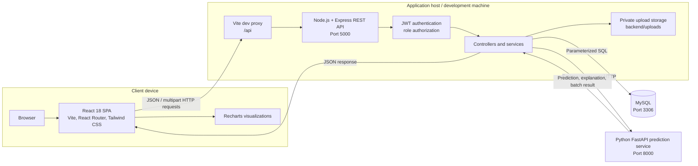
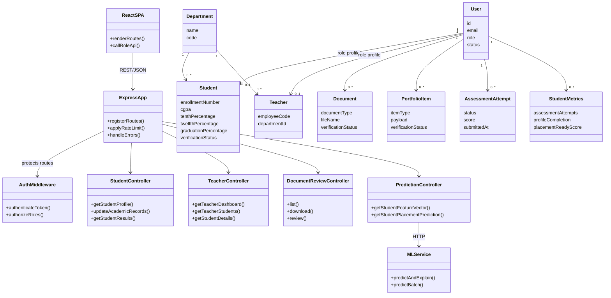
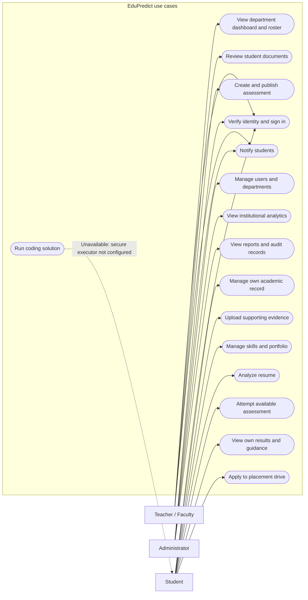
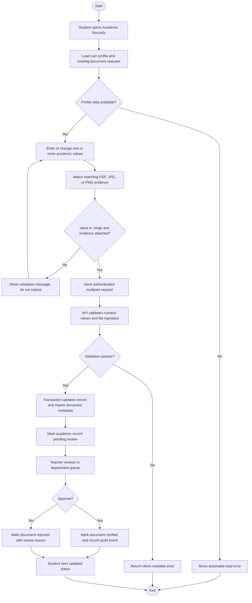
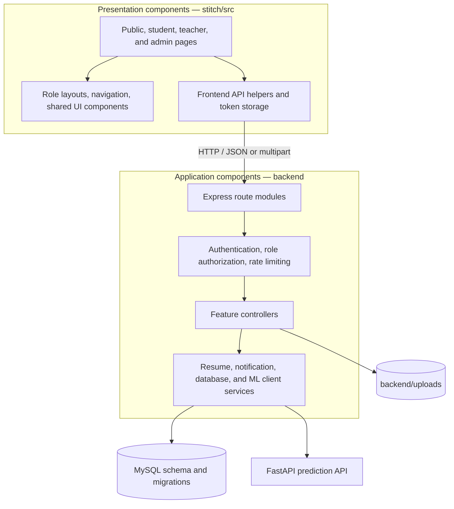

# EduPredict — Detailed Project Report

> **Project:** Smart Student Academic & Placement Prediction System  
> **Report date:** 25 November 2026  
> **Report basis:** Current repository implementation, configuration, database scripts, and tests.  
> **Audience:** Project evaluators, students, faculty, administrators, and maintainers.

## Important implementation note

This report distinguishes implemented behavior from design intent. The current repository contains working role-based portals, student record and portfolio workflows, document review, assessment records, analytics, resume scoring, and a placement-prediction prototype. Some capabilities described in older project material are not fully operational in the current source: secure code execution is not configured and returns HTTP 503; the placement model is trained on generated data rather than validated institutional outcomes; and the career assistant uses programmed response templates rather than a connected generative-AI provider. These are identified as limitations and future work below.

## Contents

1. [Introduction](#1-introduction)
   1.1 [Existing System](#11-existing-system)
   1.2 [Need for System](#12-need-for-system)
   1.3 [Scope of System](#13-scope-of-system)
   1.4 [Operating Environment — Hardware and Software](#14-operating-environment--hardware-and-software)
   1.5 [Brief Description of Technology Used](#15-brief-description-of-technology-used)
2. [Proposed System](#2-proposed-system)
   2.1 [Feasibility Study](#21-feasibility-study)
   2.2 [Objectives of Proposed System](#22-objectives-of-proposed-system)
   2.3 [Users of System](#23-users-of-system)
3. [Analysis and Design](#3-analysis-and-design)
   3.1 [System Requirements](#31-system-requirements)
   3.2 [Module Hierarchy Diagram](#32-module-hierarchy-diagram)
   3.3 [Architecture Diagram](#33-architecture-diagram)
   3.4 [Class Diagram](#34-class-diagram)
   3.5 [Use-case Diagram](#35-use-case-diagram)
   3.6 [Sequence Diagram](#36-sequence-diagram)
   3.7 [Activity Diagram](#37-activity-diagram)
   3.8 [Component Diagram](#38-component-diagram)
   3.9 [Deployment Diagram](#39-deployment-diagram)
   3.10 [Sample Input and Output Screens](#310-sample-input-and-output-screens)
4. [Coding](#4-coding)
   4.1 [Code Snippets](#41-code-snippets)
5. [Testing Process](#5-testing-process)
   5.1 [Test Planning](#51-test-planning)
   5.2 [Software Testing Life Cycle (STLC)](#52-software-testing-life-cycle-stlc)
   5.3 [Types of Testing](#53-types-of-testing)
   5.4 [Sample Test Cases](#54-sample-test-cases)
6. [Reports](#6-reports)
7. [Summary, Conclusion, and Interpretation](#7-summary-conclusion-and-interpretation)
8. [Limitations of System](#8-limitations-of-system)
9. [Proposed Enhancements / Future Scope](#9-proposed-enhancements--future-scope)
10. [Key Learnings from Project](#10-key-learnings-from-project)
11. [Bibliography](#11-bibliography)

---

# 1. Introduction

EduPredict is a web-based academic portfolio, assessment, analytics, and placement-readiness platform. Its purpose is to bring student academic records, supporting documents, assessed skills, faculty review, and placement guidance into one application. It has three principal roles—student, teacher/faculty, and administrator—with a portal tailored to each role.

The application is implemented as a React single-page application, a Node.js/Express REST API, a MySQL relational database, and a separate Python/FastAPI prediction service. The browser communicates with the Express API. The API reads and writes institutional data in MySQL and calls the prediction service when a placement forecast is requested.

## 1.1 Existing System

In a conventional academic and placement workflow, information can be spread across spreadsheets, email, paper documents, learning systems, and placement-cell records. Faculty may have to request evidence separately, students may not know which profile items remain incomplete, and placement staff may lack a consistent view of assessed performance.

Typical difficulties include:

- Academic marks and supporting documents being maintained in different places.
- Repeated entry of student identity and academic information.
- Unclear review status for marksheets, certificates, and other evidence.
- Assessment results being disconnected from a student's broader portfolio.
- Reports being compiled manually from multiple sources.
- Placement decisions relying on incomplete or inconsistent records.

EduPredict provides a shared software workflow for these tasks. It is a project implementation, not evidence that a specific institution has replaced all its existing systems or deployed it at production scale.

## 1.2 Need for System

The system is intended to:

1. Give each authenticated person access to the portal and data appropriate to their role.
2. Let students maintain academic values and portfolio records alongside evidence files.
3. Give faculty a department-scoped roster and a queue for reviewing submitted documents.
4. Store assessment attempts and results against the student who completed them.
5. Summarize available data using database-backed charts and dashboard metrics.
6. Provide a placement-readiness estimate only when the required academic and assessment data is present.
7. Reduce repeated manual reporting while making missing data and review state visible.

## 1.3 Scope of System

### Included in the current source

- Institutional identity verification, OTP verification, registration, login, password reset, and JWT-protected API access.
- Student dashboard and profile information scoped to the logged-in student.
- Student-submitted CGPA, 10th, 12th, and graduation percentages with matching evidence uploads.
- Student skills, projects, certifications, and internships stored in the database; project links and certificate uploads are supported by the corresponding portfolio workflow.
- Student resume analysis using typed text, PDF, DOCX, or TXT input, with optional job-description comparison.
- Student aptitude/general assessment listing, attempt creation, response submission, and result retrieval.
- Teacher department dashboard, department student roster, student detail view, analytics, assessments, notifications, and document review.
- Administrator user and department management, dashboard, analytics, notifications, and reports.
- Department and student performance visualizations, with empty and unavailable states when there is no data.
- Notifications addressed to students, including teacher recipient scope limited to that teacher's department.
- Placement-prediction API and rule-based recommendations, using academic, assessment, skills, and portfolio features.
- Placement-drive and application APIs in the backend.

### Present but incomplete or constrained

- Coding challenge records and problem-management routes exist, but code execution and autograding explicitly return “Secure code execution service is not configured.” They must not be treated as operational assessment functions.
- Placement-drive APIs exist, but the current React route tree does not include a dedicated student/admin placement-drive screen.
- The prediction microservice is a prototype. Its training path generates synthetic records when its saved JSON model bundle is absent.
- Resume “ATS” results are produced by deterministic checks and weights, not by an employer's ATS product.
- The career assistant's chat, interview questions, roadmap, and cover-letter outputs are fixed/programmatic templates with profile context, not responses from a connected LLM.

## 1.4 Operating Environment — Hardware and Software

The values below separate repository-declared software requirements from practical local-development recommendations. The resource figures are recommendations for a small demonstration and have not been established by a load benchmark.

### Hardware

| Environment | Recommended resources | Purpose |
|---|---:|---|
| Developer/evaluator machine | 4 CPU cores, 8 GB RAM, 10 GB free storage | Browser, Node services, MySQL, and Python environment on one machine |
| Small demonstration server | 4 CPU cores, 8 GB RAM, SSD storage sized for database and uploaded files | Concurrent access by a small class or evaluator group |
| Client device | Modern desktop, laptop, or mobile device with a current browser | Access the React web application |
| Network | Local network or internet connection to the deployed host | Browser-to-API and API-to-database/ML communication |

These are not formal performance guarantees. Production sizing requires measurements for expected concurrent users, database size, upload retention, and prediction workload.

### Software

| Layer | Current technology/configuration |
|---|---|
| Frontend | React 18, React Router 6, Vite 5, Tailwind CSS 4, Recharts |
| API backend | Node.js, Express 4, `mysql2`, JSON Web Tokens, `bcryptjs`, Multer |
| Database | MySQL-compatible relational database; project setup documents MySQL 8+ and MariaDB 10.5+ |
| Prediction service | Python, FastAPI, Uvicorn, Pydantic, NumPy, Pandas |
| Resume extraction | `pdf-parse` for PDF and `mammoth` for DOCX; TXT is decoded as UTF-8 |
| Development/test tooling | Node's built-in test runner, Pytest, Vite production build |
| Optional orchestration | Docker Compose configuration is present; deployment configuration must be reviewed before production use |

Repository setup documentation specifies Node.js 18+ and Python 3.10–3.12. The frontend Vite server is configured on port `3000` and proxies `/api` to the Express API on port `5000`. The prediction service defaults to port `8000`; MySQL defaults to port `3306`.

### Environment variables and data prerequisites

The backend reads database connection settings and authentication configuration from environment variables, including `DB_HOST`, `DB_PORT`, `DB_USER`, `DB_PASSWORD`, `DB_NAME`, and `JWT_SECRET`. Email OTP delivery requires SMTP configuration. Local development may use the explicitly marked demo email mode; that is not an appropriate production delivery mechanism.

The database uses a base schema plus incremental SQL scripts/migrations for later features. A fresh setup must apply the base schema and all required feature migrations in a documented order, then seed any institution-specific identity records. The base `schema.sql` alone does not create every later-phase table.

### Local development startup (Windows)

Run the services in separate terminals after configuring `.env`, starting MySQL, and applying the required schema files and seed data:

```powershell
npm --prefix backend install
npm --prefix stitch install
.\.venv\Scripts\python.exe -m pip install -r ml\requirements.txt
node backend\server.js
.\.venv\Scripts\python.exe -m uvicorn ml.app:app --host 127.0.0.1 --port 8000
npm --prefix stitch run dev
```

Open `http://127.0.0.1:3000`. Vite proxies `/api` requests to `http://127.0.0.1:5000`; the backend uses MySQL on port `3306` and calls the prediction API on port `8000`. These commands assume that the virtual environment already exists. The repository also provides Windows launch scripts; consult [README.md](../README.md) for setup details and verify the SQL migration order for the target database.

## 1.5 Brief Description of Technology Used

- **React** renders interactive role-specific pages in the browser. React Router maps URLs such as `/student/dashboard`, `/teacher/analytics`, and `/admin/users` to page components.
- **Vite** serves the frontend during development and creates the production browser bundle.
- **Tailwind CSS 4** and project CSS provide responsive layout and component styling.
- **Recharts** renders interactive charts from API response data.
- **Express** exposes REST API routes and delegates business logic to controllers and services.
- **JWT and bcryptjs** support signed bearer-token authentication and password hashing.
- **Multer** accepts multipart document uploads with configured size and MIME filters; controllers perform additional format and signature validation for relevant workflows.
- **MySQL** stores accounts, departments, academic data, documents, assessment attempts, portfolio items, notifications, and metrics using relational keys and indexes.
- **FastAPI** validates prediction request models and serves health, metadata, single-prediction, explanation, and batch-prediction endpoints.
- **NumPy/Pandas** support feature processing and training in the current prediction prototype. The repository's observed training implementation is a custom sigmoid/logistic-style model using gradient descent, not a proof of a production-trained scikit-learn or XGBoost model.

# 2. Proposed System

The proposed system combines a student's portfolio and assessment history with faculty verification and institution-level reporting. A user first authenticates. The API identifies the user's role and data scope, then the React client displays the corresponding portal. Data submitted by a student is stored under that student's account. Teacher review and analytics are constrained by the teacher's department. Administrator functions are institution-wide.

The platform's prediction output should be interpreted as decision support for exploration and student guidance—not as a hiring decision, guarantee of employment, or replacement for faculty judgment.

## 2.1 Feasibility Study

### Technical feasibility

The project uses widely available web technologies and has a clear separation between browser UI, REST API, database, and Python prediction service. Local development is feasible on a machine that has Node.js, Python, and MySQL installed. The most significant technical blockers for a production-quality release are secure code-execution infrastructure, real-cohort model validation, formal migration orchestration, secure file-storage operations, and deployment hardening.

### Operational feasibility

The three roles correspond to familiar institutional responsibilities:

- Students maintain records, submit proof, and view their own results.
- Teachers review department student submissions and monitor department performance.
- Administrators manage users/departments and view system-level analytics.

Operational adoption would require institutional identity data to be loaded and kept accurate, staff training, document-retention rules, and a defined workflow for rejected or disputed records.

### Economic feasibility

The application is based primarily on open-source frameworks and libraries. Development and a small demonstration can use existing machines and a local MySQL instance. Production costs are not zero: hosting, database backups, file storage, email delivery, monitoring, security review, and maintenance must be budgeted. No formal cost-benefit study or institutional procurement estimate is included in this repository.

### Schedule and resource feasibility

The system can be demonstrated incrementally: authentication and database setup first, student portfolio and teacher review next, then analytics and prediction. Completing production code execution, model evaluation, comprehensive accessibility work, and deployment hardening requires additional specialist effort and testing.

### Legal, privacy, and ethical feasibility

Academic records, identity information, resumes, and assessment results are sensitive student data. An institution must determine applicable privacy and retention obligations, authorized access, consent and notice requirements, data-subject processes, and acceptable use of predictive scores before deployment. The current repository does not establish legal compliance or a formal algorithmic fairness assessment.

## 2.2 Objectives of Proposed System

1. Consolidate student academic and career-readiness records in an account-based application.
2. Require supporting documents for submitted or changed academic values.
3. Make document review status and teacher feedback part of an auditable workflow.
4. Restrict each role's API access and scope the student/teacher data it can retrieve.
5. Provide assessment results based on recorded attempts rather than fabricated sample values.
6. Summarize actual stored data in dashboards and charts.
7. Give students understandable, caveated guidance from available profile and assessment features.
8. Offer a maintainable architecture that can be extended with production-grade assessment execution, model validation, and deployment controls.

## 2.3 Users of System

| User | Main responsibilities | Current application capabilities |
|---|---|---|
| Student | Maintain own profile and portfolio; submit academic and certificate evidence; complete available assessments; review personal results and guidance | Student dashboard, academic records, skills, projects, certifications, internships, resume, assessments, results, placement analysis, notifications |
| Teacher / Faculty | Review evidence; monitor students in the official department; create/publish available assessments; communicate with students | Department dashboard, assigned-student list/details, document verification, assessment/results, analytics, notifications |
| Administrator | Maintain users and departments; monitor aggregate institutional data; review audit/reporting views | Admin dashboard, user management, department management, analytics, reports, notifications |
| System operator / developer | Configure environment, initialize database, run services, troubleshoot logs and tests | Setup scripts, configuration templates, database SQL, tests, Docker Compose file |

# 3. Analysis and Design

## 3.1 System Requirements

### Functional requirements

| ID | Requirement | Current behavior/status |
|---|---|---|
| FR-01 | Authenticate using institutional email or ID and password. | Implemented; account lookup uses email or institutional ID and compares a stored password hash. |
| FR-02 | Register only against an institutional identity record and verify email with OTP. | Implemented through identity-record lookup, OTP challenge, and account activation. SMTP must be configured outside demo mode. |
| FR-03 | Issue a signed access token and enforce role-protected API routes. | Implemented with JWT middleware and role checks. |
| FR-04 | Show a student their own academic profile and summary. | Implemented; queries are scoped to the authenticated user ID. |
| FR-05 | Allow students to add/update CGPA and school/graduation percentages with evidence. | Implemented; value ranges and file formats are validated and submissions are marked pending review. |
| FR-06 | Allow students to maintain skills and portfolio items. | Implemented for skills, projects, certifications, and internships. Certification and internship records accept supporting certificate uploads; projects accept HTTP(S) links. |
| FR-07 | Allow the student to submit resume text and/or a soft copy for role-focused analysis. | Implemented for text, PDF, DOCX, and TXT with a deterministic score and section/keyword feedback. |
| FR-08 | Let teachers list students assigned by institutional department. | Implemented by matching the teacher's department to student department; active accounts are used in roster queries. |
| FR-09 | Allow teachers to inspect student records and review uploaded documents. | Implemented with department-scoped student and document queries. A document can be marked verified/rejected; rejection requires a reason. |
| FR-10 | Allow teachers to create/publish assessments and view recorded results. | Implemented for the current assessment APIs; student assessment flow records attempts/responses and evaluates available answers. |
| FR-11 | Return student results only from recorded assessment attempts. | Implemented in student results endpoints and UI; no attempt means no result record. |
| FR-12 | Provide admin/teacher/student dashboards and analytics from stored data. | Implemented for the current dashboard/analytics endpoints. Empty results are shown as empty/unavailable instead of invented values in key updated pages. |
| FR-13 | Send notifications to students and track read state. | Implemented. Teacher recipients are limited to the teacher's department; admins can address institution students. |
| FR-14 | Produce a placement readiness estimate and an explanation. | Implemented as a prototype API, subject to complete/verified features and an available ML service. Model validity is not established for real hiring decisions. |
| FR-15 | Create placement drives, compute eligibility, and manage applications. | Backend routes/controllers exist. A complete dedicated drive workflow is not present in the current React route tree. |
| FR-16 | Run and grade arbitrary student code securely. | **Not currently available.** The controller returns HTTP 503 until a secure execution service is configured. |

### Non-functional requirements

| Category | Requirement / design expectation |
|---|---|
| Security | Enforce bearer-token authentication and role checks; use parameterized SQL for database inputs; hash passwords; validate upload size/type/content; avoid exposing server file paths to client responses. |
| Privacy | Return only information needed by the authenticated role and scope; keep student records and uploads private; document lawful retention and consent before deployment. |
| Reliability | Report API failures explicitly; do not convert failed or absent analytics into fabricated success values. Keep the database and ML service health checks available. |
| Performance | Paginate large rosters, use database indexes, and avoid retrieving unlimited reports. Define and measure latency targets under representative concurrent load before production. |
| Usability | Provide clear labels, loading/error/empty states, role-appropriate navigation, and responsive layouts. Validate the experience using keyboard and assistive-technology testing. |
| Maintainability | Keep presentation, route/controller, service, and persistence responsibilities separated. Add focused automated tests for behavior and regression cases. |
| Portability | Use supported Node/Python/MySQL environments and environment-based configuration rather than committing deployment credentials. |
| Data integrity | Use foreign keys, unique identity constraints, transactions for multi-record submissions, and status values to represent verification and assessment lifecycle. |

## 3.2 Module Hierarchy Diagram

```mermaid
flowchart TD
    EP[EduPredict]
    EP --> PUB[Public and Authentication]
    EP --> PORT[Authenticated Portals]
    EP --> API[Express REST API]
    EP --> DB[MySQL Data Store]
    EP --> ML[Placement Prediction Service]

    PUB --> LAND[Landing and information pages]
    PUB --> AUTH[Login, registration, password reset]
    AUTH --> OTP[Institutional identity and OTP]

    PORT --> ST[Student Portal]
    PORT --> TE[Teacher Portal]
    PORT --> AD[Administrator Portal]

    ST --> ST1[Profile and academic records]
    ST --> ST2[Skills and portfolio]
    ST --> ST3[Resume analysis]
    ST --> ST4[Assessments, results, placement analysis]
    ST --> ST5[Notifications]

    TE --> TE1[Department dashboard and roster]
    TE --> TE2[Student details and analytics]
    TE --> TE3[Document verification]
    TE --> TE4[Assessments and notifications]

    AD --> AD1[User and department management]
    AD --> AD2[Institutional analytics and reports]
    AD --> AD3[Notifications and audit view]

    API --> AUTHAPI[Authentication routes]
    API --> STUDENTAPI[Student routes]
    API --> TEACHERAPI[Teacher routes]
    API --> ADMINAPI[Admin and analytics routes]
    API --> OTHERAPI[Assessment, resume, reports, jobs, notifications]
    API --> MLCLIENT[ML service client]
```



## 3.3 Architecture Diagram



**Request path:** a role-specific page calls a frontend API helper. The request passes through the Vite `/api` proxy during local development, then through Express routing and authentication middleware. The controller checks the user's role and data scope, reads or updates MySQL, and returns JSON. Placement prediction is delegated to the separate FastAPI service.

## 3.4 Class Diagram

The codebase primarily uses JavaScript modules, functions, and SQL records rather than a traditional object-oriented domain-model hierarchy. This is a **logical class/entity diagram** of the main software responsibilities and data relationships.

### Core database entities

| Domain | Main records | Relationship summary |
|---|---|---|
| Identity and organization | `roles`, `users`, `institutional_identity_records`, `departments`, `batches`, `academic_years`, `students`, `teachers`, `admins` | One account has a role-specific profile; students and teachers are associated with departments, and students belong to batches. |
| Student evidence | `documents`, `student_portfolio_items`, `skill_proficiency` | Documents and portfolio entries belong to a user; portfolio items represent projects, certifications, or internships. |
| Assessment | `assessments`, `assessment_questions`, `assessment_attempts`, `student_assessment_responses`, coding tables | Assessments contain questions and student attempts; score/result availability depends on the evaluation path. |
| Analytics | `student_metrics`, `department_metrics`, `batch_metrics`, `at_risk_students`, `assessment_question_analytics` | Aggregated or cached metrics summarize assessment and readiness information for dashboards. |
| Communication and placement | `notifications`, `audit_logs`, `job_drives`, `job_applications` | Notifications and audit events record user-facing communication and reviews; applications link students to drives. |



## 3.5 Use-case Diagram

This role/use-case map summarizes the main interactions exposed by the current portal and API.



The placement-drive application functions are exposed by backend APIs, but a full dedicated front-end flow is not currently present in the React route tree. The coding use case is shown for completeness and marked unavailable.

## 3.6 Sequence Diagram

### Student academic record submission and faculty review

```mermaid
sequenceDiagram
    actor Student
    participant UI as React Student Portal
    participant API as Express API
    participant Auth as JWT/Role Middleware
    participant DB as MySQL
    participant Disk as Private Upload Directory
    actor Teacher
    participant ReviewUI as React Teacher Portal

    Student->>UI: Enter academic value and choose evidence file
    UI->>API: PUT /api/student/academic-records (multipart)
    API->>Auth: Validate token and student role
    Auth-->>API: Authenticated user ID
    API->>API: Validate score range and uploaded file signature
    API->>DB: Begin transaction; update student record
    API->>Disk: Move file into user-specific upload directory
    API->>DB: Insert document metadata with pending status
    API->>DB: Commit transaction
    API-->>UI: Success, submitted values, pending document status

    Teacher->>ReviewUI: Open department document queue
    ReviewUI->>API: GET /api/teacher/verifications
    API->>Auth: Validate token and teacher role
    Auth-->>API: Authenticated teacher ID
    API->>DB: Select documents in teacher's department
    API-->>ReviewUI: Pending/document records
    Teacher->>ReviewUI: Approve or reject with reason
    ReviewUI->>API: PUT /api/teacher/verifications/:id
    API->>DB: Verify department scope and pending state
    API->>DB: Update status and append audit log
    API-->>ReviewUI: Review result
```

## 3.7 Activity Diagram



## 3.8 Component Diagram



## 3.9 Deployment Diagram

```mermaid
flowchart LR
    Client["User device<br/>Browser"]
    DevFrontend["Vite development server<br/>port 3000"]
    WebFrontend["Production static frontend<br/>container port 80 / host port 3000"]
    API["Express backend<br/>port 5000"]
    DB["MySQL server<br/>port 3306"]
    ML["FastAPI service<br/>port 8000"]
    Storage["Backend upload volume<br/>private evidence files"]

    Client -->|HTTP(S)| DevFrontend
    Client -->|HTTP(S)| WebFrontend
    DevFrontend -->|/api proxy| API
    WebFrontend -->|Nginx /api proxy| API
    API --> DB
    API --> ML
    API --> Storage
```

The repository includes Windows launch scripts and a Docker Compose file. The supplied Nginx configuration proxies `/api/` to the backend; verify that this matches the production API base path. Also verify that all required SQL migrations are applied, secrets are injected securely, and persistent volumes/backups are configured. The diagram describes logical deployment nodes and does not guarantee a production-ready configuration.

## 3.10 Sample Input and Output Screens

The following are **illustrative text wireframes**, not captured screenshots. They use the actual page purposes and representative fields from the current application. Live output depends on the signed-in user and database contents.

### A. Unified login

```text
+----------------------------------------------------+
| EduPredict                    [Theme]              |
| Smart Student Academic & Placement Prediction      |
|                                                    |
|                 Account Sign In                    |
|  Official Email or University ID                   |
|  [ student@university.edu / 21CS042             ]  |
|  Password                                          |
|  [ •••••••••••••••••                         ]  |
|  [ Sign In to Portal ]     Forgot Password?        |
|                                                    |
|  Successful login routes the user to the dashboard|
|  matching the role returned by the authentication  |
|  API: student, teacher, or admin.                   |
+----------------------------------------------------+
```

### B. Student academic records — sample input

| Field | Example input | Supporting document |
|---|---:|---|
| Cumulative GPA | `8.20` | `current-transcript.pdf` |
| 10th Percentage | `88.50` | `class-10-marksheet.jpg` |
| 12th Percentage | `84.25` | `class-12-marksheet.pdf` |
| Graduation Percentage | `82.00` | `semester-summary.png` |

The client and API constrain CGPA to 0–10 and percentage values to 0–100. A changed value must be submitted with its corresponding document. The upload limit for this workflow is 5 MB per file.

### C. Student academic records — representative output

```text
Academic Records & Transcripts
  Cumulative GPA             8.20
  10th Percentage           88.50
  12th Percentage           84.25
  Graduation Percentage    82.00

  Academic verification: Pending
  10th evidence: class-10-marksheet.jpg [Pending]
  12th evidence: class-12-marksheet.pdf [Pending]
  Message: Submitted for faculty review.
```

The example values above are fabricated for illustration and are not an assertion about a real account.

### D. Teacher dashboard — representative output

```text
Teacher Dashboard                         Department: [from account]
  Assigned Students:             [database count]
  Pending Academic Records:      [database count]
  Department Average CGPA:       [database average or —]
  Active Assessments:            [database count]
  Students Meeting Readiness:    [value or — when unavailable]

  Academic Performance by Batch [bar chart]
  Placement Readiness by Batch  [bar chart]
  Pending Academic Record Reviews [department-scoped rows]
```

### E. Administrator analytics — chart outputs

```text
Campus Analytics
  Student Performance       [bar chart: evaluated-score bands]
  Department Distribution   [donut: active students by department]
  Assessment Results        [pie: evaluated pass / needs-support]
  Academic Trends           [line: monthly normalized score]
  Skills Comparison         [radar: assessed skill categories]
  Placement Readiness       [bar: stored readiness by department]
```

The analytics page shows loading, unavailable, or no-data messages where the underlying records do not exist. An empty assessment table does not produce invented student results.

### F. Student resume analysis — sample input/output

**Input:** target role `Software Development`; resume text (or readable PDF/DOCX/TXT); optional job description.  
**Output:** an ATS estimate, grade, detected sections, keyword coverage, impact/length breakdown, and improvement suggestions. The score is a local rule-based estimate, not the score from a third-party ATS.

### G. Student results

```text
Results & Rank
  Assessment title | Type | Submitted | Score | Maximum
  [Rows appear only for recorded/evaluated attempts.]

  If there are no evaluated attempts:
  "No assessment results are available yet."
```

# 4. Coding

## 4.1 Code Snippets

The following short examples are taken from the current implementation and illustrate the primary patterns. They are not intended to replace the full source or deployment instructions.

### A. Student-owned profile query

The API uses the authenticated account ID rather than accepting a student ID from the page when returning a student's own profile:

```javascript
const { id: userId } = req.user;

const [rows] = await db.query(
  `SELECT s.id, u.full_name, u.email, d.name AS department, b.name AS batch,
          s.enrollment_number, s.cgpa, s.tenth_percentage, s.twelfth_percentage,
          s.graduation_percentage, s.verification_status
   FROM students s
   INNER JOIN users u ON u.id = s.user_id
   INNER JOIN departments d ON d.id = s.department_id
   INNER JOIN batches b ON b.id = s.batch_id
   WHERE s.user_id = ?`,
  [userId]
);
```

### B. JWT creation

```javascript
return jwt.sign(
  { id: user.id, email: user.email, role: user.role_name || user.role },
  process.env.JWT_SECRET,
  { expiresIn: process.env.JWT_EXPIRES_IN || '7d' }
);
```

The authentication middleware verifies the token and re-reads the active user and role from MySQL before passing the request to protected route handlers.

### C. Score and document validation

The academic-record API validates the field-specific maximum before updating data. The controller also checks that the uploaded file's bytes match the declared PDF/JPEG/PNG type, stores the file under the authenticated user's upload directory, and creates a pending document record in a database transaction.

```javascript
const value = Number(textValue);
if (!Number.isFinite(value) || value < 0 || value > field.max) {
  return res.status(400).json({
    success: false,
    message: `${field.key.replace(/_/g, ' ')} must be between 0 and ${field.max}.`
  });
}
```

### D. Placement feature engineering

The Python preprocessing pipeline creates composite features from the request fields:

```python
df['academic_index'] = (
    (df['cgpa'] * 10 * 0.5) +
    (df['tenth_percentage'] * 0.25) +
    (df['twelfth_percentage'] * 0.25)
)

df['technical_index'] = (
    (df['aptitude_score'] * 0.45) +
    (df['coding_score'] * 0.55)
)
```

Other engineered values include experience, backlog penalty, and holistic readiness. The current prediction is based on a generated training dataset and should be validated and calibrated before institutional use.

### E. Parameterized database access

Queries use placeholders for user-supplied values. This keeps data separate from SQL syntax:

```javascript
await db.query(
  'SELECT id FROM teachers WHERE user_id = ?',
  [user.id]
);
```

## 4.2 Main Code Organization

| Location | Responsibility |
|---|---|
| `stitch/src/App.jsx` | Public, student, teacher, and admin route tree |
| `stitch/src/pages/` | Role-specific React screens |
| `stitch/src/services/` | Frontend HTTP clients and authentication token storage |
| `backend/app.js` | Express setup, CORS, JSON parsing, rate limiting, API route registration, error handling |
| `backend/routes/` | HTTP endpoint definitions and middleware attachment |
| `backend/controllers/` | Authentication, academic, teacher, admin, assessment, analytics, and reporting workflows |
| `backend/services/` | Database-related helpers, notifications, resume parsing/scoring, and prediction-service client |
| `backend/middleware/auth.js` | JWT validation and role authorization |
| `database/` | Base schema, feature schemas, migration, and seed data |
| `ml/app.py` | FastAPI health, model information, and prediction endpoints |
| `ml/preprocessing/` and `ml/models/` | Feature pipeline, synthetic-data training, prediction model, and explanations |
| `backend/tests/`, `ml/tests/` | Backend behavior tests and ML API tests |

# 5. Testing Process

## 5.1 Test Planning

Testing should validate the critical data paths and the boundaries between roles, not only that a page renders. The highest-risk paths are authentication and account scope, academic value/document consistency, teacher department boundaries, assessment result provenance, upload handling, and prediction readiness requirements.

### Test objectives

- Confirm login succeeds only for active users with valid credentials.
- Confirm each role is restricted to its permitted routes and records.
- Confirm student data reads/writes are scoped to the authenticated account.
- Confirm score ranges, matching evidence, and file type/size checks.
- Confirm teachers can only review documents and view students in their department.
- Confirm dashboards distinguish “no records” from “request failed.”
- Confirm result rows are created from submitted/evaluated attempts only.
- Confirm prediction is blocked when required verified inputs or assessment results are missing.
- Confirm the main frontend production build completes.

### Entry criteria

- Dependencies are installed from the checked-in manifests.
- MySQL is running and the base schema, required feature schemas, and seed/test data are applied.
- Backend and ML service environment variables are configured.
- Test accounts exist for all roles, ideally in two separate departments for scope tests.
- Upload test files are non-sensitive, valid fixtures.

### Exit criteria

- No open blocker in authentication, record ownership, department authorization, or file safety.
- Focused backend and ML suites pass.
- Frontend production build succeeds.
- Empty-data and error states have been checked.
- Any known incomplete feature is disclosed; code execution is not represented as available.

## 5.2 Software Testing Life Cycle (STLC)

| Stage | Work for EduPredict | Deliverable |
|---|---|---|
| Requirement analysis | Map student, teacher, admin, privacy, and data-integrity requirements to current routes and pages. | Requirements-to-tests matrix |
| Test planning | Prioritize critical workflows, roles, test data, environment, and release risks. | Test plan and schedule |
| Test case design | Define normal, invalid, boundary, no-data, and unauthorized cases. | Test cases and sample data |
| Environment setup | Start MySQL, apply all needed SQL scripts, configure `.env`, start API/ML/UI. | Repeatable test environment |
| Test execution | Run Node tests, Python tests, API checks, and frontend production build. | Execution log and defects |
| Defect reporting/retest | Record reproduction steps; test the fix and related regression cases. | Defect record and retest result |
| Test closure | Summarize pass/fail, unresolved gaps, model caveats, and release readiness. | Test closure report |

### Repository test commands

Run commands from the repository root in PowerShell:

```powershell
npm --prefix backend test
.\.venv\Scripts\python.exe -m pytest ml\tests -v
npm --prefix stitch run build
```

The automated tests are located under [backend/tests/](../backend/tests/) and [ml/tests/](../ml/tests/). The test suite should be rerun against the exact database migrations and environment used for evaluation. This documentation change does not modify application code and does not constitute a fresh application test run.

## 5.3 Types of Testing

1. **Unit testing:** Validate individual controllers, feature transformations, score calculations, and input validation.
2. **Integration testing:** Validate API-to-MySQL behavior, transactions, notification persistence, file metadata, and API-to-ML requests.
3. **End-to-end testing:** Exercise a user journey from login through record submission, teacher review, and student-visible status.
4. **Authorization testing:** Check unauthenticated, wrong-role, wrong-student, and wrong-department requests.
5. **Negative and boundary testing:** Test missing values, invalid ranges, oversized uploads, wrong file signatures, expired OTPs, and incomplete prediction inputs.
6. **Regression testing:** Rerun tests for previously repaired login, profile scoping, academic submission, teacher records, and analytics empty states.
7. **Build testing:** Run Vite's production build to catch bundling and import errors.
8. **Usability/accessibility testing:** Check responsive layout, keyboard access, labels, focus states, and understandable error text.
9. **Performance testing:** Not established by the current automated tests. Add a controlled dataset and load test before claiming production latency or capacity.
10. **ML validation/fairness testing:** The existing generated-data test is useful for API shape and smoke behavior only; it is not evidence of real-world predictive accuracy or fairness.

## 5.4 Sample Test Cases

These are report-ready test cases. “Expected” describes the acceptance condition; execute them in the target environment and record the actual response before using this table as a signed test-results report.

| ID | Scenario / input | Expected result | Priority |
|---|---|---|---|
| TC-01 | Student logs in with a valid institutional email and password. | `200` response with a valid token and `student` role; UI opens the student dashboard. | High |
| TC-02 | User submits an incorrect password. | Authentication is rejected; no token is issued; UI displays a useful error. | High |
| TC-03 | Student A calls the own-profile endpoint while authenticated as Student A. | Profile belongs only to Student A. | High |
| TC-04 | Student A attempts to access or modify Student B's private record. | Request is denied or endpoint returns only the authenticated user's record. | Critical |
| TC-05 | Student submits CGPA `8.20` and a valid matching PDF. | Academic value is stored, document metadata is created, and review state becomes pending. | High |
| TC-06 | Student submits percentage `101` or changes a value without its required evidence. | API rejects the request; invalid value is not committed. | High |
| TC-07 | Student uploads a file whose extension/MIME claims PDF but whose bytes are not a PDF. | Upload is rejected and no verified document state is created. | High |
| TC-08 | Teacher views students in their own department. | Active students from that department appear; records from another department do not. | Critical |
| TC-09 | Teacher tries to download or review a document belonging to another department. | Access is denied/not found; no file is returned or modified. | Critical |
| TC-10 | Teacher rejects a pending document without a comment. | API rejects the review; status remains pending. | Medium |
| TC-11 | Student has no evaluated assessment attempts and opens Results. | No fabricated result/rank appears; UI shows an empty state. | High |
| TC-12 | Student requests placement analysis without verified academic data or evaluated aptitude/coding assessments. | API returns a validation response describing the missing prerequisites rather than a forecast. | High |
| TC-13 | Student submits a notification request to mark their own notification read. | Only that user's notification read state changes. | Medium |
| TC-14 | Student attempts to call an admin-only analytics endpoint. | API returns `403 Forbidden`. | High |
| TC-15 | Student calls a coding run/submit endpoint while no secure executor is configured. | API returns `503 Service Unavailable`; it must not claim the code was executed or graded. | High |
| TC-16 | Frontend production build command is run. | Vite completes and produces the production bundle. | Medium |

# 6. Reports

The system's reports are generated from saved records and aggregated metrics. The visual pages are useful only to the extent that source records are present, current, and correctly verified.

## 6.1 Available report and analytics outputs

- **Student dashboard:** Own academic summary, profile completion, verified-document count, and student-facing tasks/announcements.
- **Student results:** Assessment attempts and evaluated scores associated with the authenticated student.
- **Teacher dashboard:** Department student count, pending academic reviews, average CGPA, owned published assessments, and readiness metrics where available.
- **Teacher analytics:** Department assessment/readiness distribution, assessed skill categories, students below the configured readiness threshold, and verified project summary.
- **Administrator dashboard:** Active student and teacher totals, department count, pending verifications, assessment count, and readiness coverage.
- **Institutional analytics:** Student performance bands, department distribution, evaluated pass/support results, monthly assessment trends, assessed-skill comparison, and stored placement-readiness percentages.
- **Document review:** Submitted evidence, status, reviewer, and audit-log event.
- **Administrative reports:** The report controller exposes student scorecard and batch CSV export endpoints.
- **Placement prediction:** Single-student placement probability, tier, status, package estimate, model metadata, feature summary, and deterministic explanatory recommendations.
- **Placement drive endpoints:** Active drives, basic criteria eligibility, applications, and candidate status; a dedicated UI flow is still to be completed.

## 6.2 Interpretation rules

- Scores from assessment attempts should only be reported after evaluation.
- Missing scores must not be treated as zero unless the report explicitly defines that calculation.
- Placement-readiness charts use records with stored readiness metrics; they are not automatically equivalent to actual placement outcomes.
- The current placement score is predictive and generated using a synthetic-data prototype; it is not an observed placement rate.
- The resume score is a heuristic estimate based on text sections, selected-role/job-description keywords, action verbs, quantified impact, and length.

# 7. Summary, Conclusion, and Interpretation

EduPredict provides a multi-role application for managing student records and career-readiness information. Its strongest implemented end-to-end workflows are authenticated student profile/academic-record submission, supporting-file storage, teacher department-scoped review, student/teacher dashboards, administrative analytics, notification handling, resume text/file analysis, and assessment record/result handling.

The architecture separates browser presentation, REST API behavior, relational data, and prediction service responsibilities. This makes the project understandable and extendable. Database ownership and department scoping are important design choices: the student portal derives the current user from the verified token, while the teacher portal derives scope from the teacher's stored department.

The most important interpretation is that “prediction” and “analysis” are currently guidance features, not validated institutional decision systems. No claim about prediction accuracy, employment outcomes, or suitability for high-stakes decisions should be made solely from the generated training data or heuristic scoring. Before production adoption, the project needs real and lawfully sourced validation data, outcome monitoring, independent security review, and completion of the unavailable code-execution and placement-drive UI workflows.

# 8. Limitations of System

1. **Coding execution is unavailable:** The code-run and submit endpoints return HTTP 503 while the secure execution service is unconfigured. A Node VM sandbox is not an adequate isolation boundary for untrusted code.
2. **Prediction model is a prototype:** The current training path can generate synthetic data. Reported benchmark comparisons in source are not a substitute for an independently reproduced evaluation on representative, consented institutional data.
3. **No fairness or calibration evidence:** The repository does not establish subgroup performance, calibration, drift monitoring, or suitability for employment decisions.
4. **Heuristic resume scoring:** The ATS score is deterministic keyword/section/length scoring, not compatibility with a specific commercial ATS or recruiter.
5. **Rule-based Career AI:** Career chat and generated materials are templates, not an external LLM integration or a verified personalized counseling service.
6. **Incomplete placement-drive user interface:** Drive/application APIs exist but are not fully represented in the current React route tree.
7. **Academic history depth:** The academic page currently captures summary values and evidence. It explicitly notes that semester-by-semester grade and credit totals are not available in the student's account yet.
8. **Migration orchestration:** The database is evolved through multiple SQL files. A clean-install migration sequence and rollback strategy need to be standardized and continuously tested.
9. **Local file storage:** Uploads are stored on the backend filesystem. Production use needs private object storage or a durable managed volume, backup/retention policy, malware scanning, and operational access controls.
10. **Email configuration dependency:** OTP and reset workflows depend on correctly configured email delivery. Development demo behavior must not be enabled in production.
11. **No proven scale or SLA:** The repository does not provide production load-test results, service-level commitments, disaster recovery exercises, or high-availability evidence.
12. **Data completeness affects outputs:** A chart, readiness estimate, or cohort comparison can be empty or misleading if source records are missing, stale, unverified, or unevenly collected.
13. **Privacy/compliance work remains:** Formal legal review, retention rules, consent/notice, incident response, and institutional data governance are deployment responsibilities not established by code alone.

# 9. Proposed Enhancements / Future Scope

## Priority 1 — Safety and release readiness

- Integrate a dedicated, isolated code runner (for example, disposable containers or an external judge service) with CPU, memory, filesystem, network, and time limits. Do not execute arbitrary submissions in the API process.
- Add integration tests for all required SQL migrations against a clean MySQL database.
- Review CORS, secrets, rate limits, upload storage, backup, access logging, and deployment settings with a security professional.
- Add observability: structured logs, request IDs, dependency health, and alerting without recording passwords, OTPs, tokens, or sensitive document contents.

## Priority 2 — Evidence and workflow completeness

- Implement the placement-drive UI for students and administrators/teachers, including eligibility explanation, application status, and shortlist management.
- Add a complete status/history view for reviewed academic records and portfolio evidence, including reviewer comments and resubmission flow.
- Add semester-wise courses, grades, credits, and transcript import where the institution can provide authoritative data.
- Improve notification delivery and controls, including read receipts and optional email notifications with user preferences.

## Priority 3 — Data and analytics

- Add a trusted institutional data import and validation pipeline with deduplication, provenance, and audit history.
- Provide explicit filters for department, batch, academic year, and assessment type; show population counts and missing-data coverage alongside charts.
- Separate observed outcomes (such as actual placements) from predictive metrics in every report.
- Add scheduled metric refreshes, query/index review, and tested pagination for large institutions.

## Priority 4 — Responsible prediction and resume analysis

- Replace synthetic-only training with a lawful, documented, representative dataset and a reproducible train/validation/test protocol.
- Track model version, dataset provenance, feature definitions, calibration, confidence, and subgroup performance.
- Define human review and appeal processes; prohibit automatic rejection or ranking decisions without institutional governance.
- Add an evaluation report comparing model predictions with observed outcomes over time.
- Improve resume analysis with configurable job-specific criteria, transparent scoring weights, accessibility, and explicit limitations.
- Connect an approved career-guidance provider only after privacy, safety, and cost controls are reviewed; retain a non-AI fallback.

## Priority 5 — Quality and accessibility

- Add end-to-end browser tests for login, data entry, document review, and result display.
- Test keyboard-only use, screen-reader labels, color contrast, mobile viewport behavior, and localization.
- Add CSV/PDF export validation and accessible chart summaries.
- Establish CI checks for backend tests, ML tests, SQL migration checks, linting, and production frontend builds.

# 10. Key Learnings from Project

- A role-specific interface is not sufficient by itself; authorization must also be enforced at the API and database-query boundary.
- A student's identity, student profile, and faculty profile are distinct records. Account creation must create the corresponding role profile from authoritative institutional data.
- Supporting-document metadata and academic values should be written consistently, preferably in a transaction, and reviewed status must be clear.
- Empty data and failed requests are different states. A dashboard should not turn a failed request into a convincing-looking zero.
- Assessment results are trustworthy only when they are tied to a real attempt and a defined evaluation rule.
- File extension and browser-provided MIME type are not sufficient proof of content; file size, content signature, storage path, and access scope also matter.
- Department-based teacher access must be applied consistently to student lists, details, documents, analytics, and notifications.
- Predictive scores need clear prerequisites, provenance, validation, and careful language. A score calculated from synthetic data is not evidence of real-world accuracy.
- A code-execution feature has a much higher security bar than ordinary API logic; timeout wrappers alone do not provide safe isolation.
- Diagrams, implementation status, test results, and future plans should be reported separately to avoid overstating project completion.

# 11. Bibliography

## Project sources

1. EduPredict repository README — [README.md](../README.md).
2. Software requirements specification — [04_SRS.md](04_SRS.md).
3. Functional requirements — [06_Functional_Requirements.md](06_Functional_Requirements.md).
4. System architecture — [09_System_Architecture.md](09_System_Architecture.md).
5. Low-level design — [11_LLD.md](11_LLD.md).
6. Database design — [12_Database_Design.md](12_Database_Design.md).
7. Entity relationship model — [13_ER_Diagram.md](13_ER_Diagram.md).
8. Base database schema and feature migrations — [database/schema.sql](../database/schema.sql), [database/migrations/](../database/migrations/), and the other SQL files under [database/](../database/).
9. API route and controller implementation — [backend/routes/](../backend/routes/) and [backend/controllers/](../backend/controllers/).
10. Frontend routes and pages — [stitch/src/App.jsx](../stitch/src/App.jsx) and [stitch/src/pages/](../stitch/src/pages/).
11. Prediction service implementation — [ml/app.py](../ml/app.py), [ml/preprocessing/pipeline.py](../ml/preprocessing/pipeline.py), and [ml/models/train.py](../ml/models/train.py).
12. Automated tests — [backend/tests/](../backend/tests/) and [ml/tests/](../ml/tests/).

## Technology references

1. React documentation, https://react.dev/learn
2. Vite documentation, https://vite.dev/guide/
3. Express documentation, https://expressjs.com/
4. MySQL documentation, https://dev.mysql.com/doc/
5. FastAPI documentation, https://fastapi.tiangolo.com/
6. Python documentation, https://docs.python.org/3/
7. Tailwind CSS documentation, https://tailwindcss.com/docs
8. Recharts documentation, https://recharts.org/en-US/guide
9. JSON Web Token specification, RFC 7519, https://www.rfc-editor.org/rfc/rfc7519
10. OWASP File Upload Cheat Sheet, https://cheatsheetseries.owasp.org/cheatsheets/File_Upload_Cheat_Sheet.html

---

**End of report**
